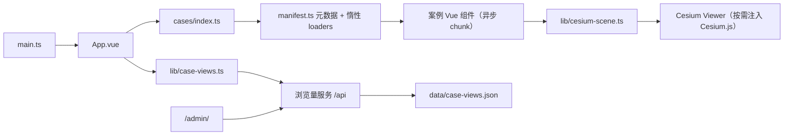

# 系统架构

## 概述

Cesium 酱の百宝箱是一个 Vue 3 单页案例中心。首页按分类筛选案例，打开案例后由对应 Vue 组件创建和销毁 Cesium Viewer。

## 技术栈

- TypeScript、Vue 3、Vite
- Cesium 1.144
- Element Plus
- Node.js 浏览量服务（无外部依赖，文件持久化）

## 结构

```text
src/
├── main.ts              # Vue 应用入口
├── App.vue              # 案例列表和全屏容器
├── cases/               # 独立案例组件及注册元数据
└── lib/                 # Cesium 场景、影像、材质与浏览量客户端工具

server/
├── index.mjs            # HTTP 服务：浏览量 API、后台接口、静态托管
├── store.mjs            # 浏览量存储（原子写入、去抖落盘、统计聚合）
└── catalog.mjs          # 案例目录读取与缓存

public/admin/            # 运营后台静态页面（/admin/）
data/                    # 运行时浏览量数据与后台口令（不入库）
```



## 加载策略

- `scripts/sync-cases.mjs` 自动扫描 `src/cases/` 生成 `manifest.ts`，首页仅加载元数据，案例组件为独立异步 chunk。
- Cesium.js 不再由首页 HTML 注入，首次悬停卡片或打开案例时按需加载（dev 为 `/cesium/Cesium.js` shim，build 为产物 `dist/cesium/`）。
- 首页加载体积与案例数量解耦。

## 浏览量服务

- 每张案例卡片底部右侧展示累计浏览量，打开可演示案例时上报一次浏览。
- 服务端校验案例标识正则并确认案例存在于 `public/data/cases.json`，避免任意键写入。
- 数据以临时文件加原子重命名落盘，500 ms 去抖，进程退出前强制写入。
- 累计浏览量永久保留；每日明细按 `VIEW_RETENTION_DAYS` 清理。
- `/admin/` 使用 `ADMIN_TOKEN`、口令文件或首次启动生成的口令鉴权，统计接口走 `Authorization: Bearer`。
- 开发态由 `scripts/dev.mjs` 同启浏览量服务与 Vite，Vite 将 `/api` 反向代理到浏览量服务。

## 新增模块

- `water-reflection`：Water 材质、水面边界、浮动物体和可切换倒影实体。
- `rectangle-depth-map`：世界地形、矩形拾取、地形采样、PNG 预览与基线 TIFF 导出。
