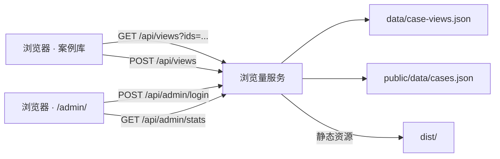
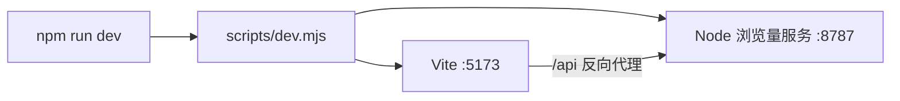

# 案例浏览量统计与运营后台技术设计

Feature Name: case-view-counter-admin
Updated: 2026-10-31

## Description

在现有 Vue 3 + Vite 纯静态案例库之上增加一个同仓 Node.js 浏览量服务。服务承担三件事：

1. 接收案例打开事件并累加持久化浏览量；
2. 为案例库提供批量浏览量查询；
3. 托管运营后台 `/admin/` 与后台统计接口，并在生产环境中直接托管 `dist/` 静态产物。

前端只在卡片底部追加浏览量徽标与上报逻辑，案例演示加载链路保持不变。

## Architecture



开发态：



部署态：单容器单端口，Node 服务同时返回静态文件与 `/api`，无需独立 nginx。

## Components and Interfaces

### 浏览量服务 `server/index.mjs`

| 方法 | 路径 | 鉴权 | 说明 |
| --- | --- | --- | --- |
| GET | `/api/health` | 否 | 存活探测 |
| GET | `/api/views?ids=a,b` | 否 | 批量返回浏览量，最多 500 个标识 |
| POST | `/api/views` | 否 | 请求体 `{ id }`，累加并返回最新值 |
| POST | `/api/admin/login` | 口令请求体 | 校验管理员口令 |
| GET | `/api/admin/stats?days=7` | Bearer | 返回总量、趋势、排行、分类与明细 |
| GET | `/api/admin/catalog` | Bearer | 返回案例目录 |

实现要点：

- `CASE_ID_RE = /^[a-z0-9][a-z0-9-]{0,63}$/`，并校验案例存在于目录，避免任意键写入。
- 限流：浏览写入每分钟 120 次/来源，登录校验每分钟 20 次/来源；超限返回 429 与 `Retry-After`。
- 口令比较使用 SHA-256 + `timingSafeEqual`，避免时序侧信道。
- 口令来源优先级：`ADMIN_TOKEN` > 数据目录 `admin-token.txt` > 首次启动随机生成并写盘（权限 600）。
- 静态托管对路径做 `normalize` 与前缀校验，阻止目录穿越；缺少扩展名时回退 `index.html`。

### 存储 `server/store.mjs`

`createViewStore` 负责加载、累加、统计与落盘，不依赖 HTTP，便于单元测试。

### 案例目录 `server/catalog.mjs`

按 mtime 缓存 `public/data/cases.json`，由 `scripts/gen-case-catalog.mjs` 在 `npm run sync` 中生成。

### 前端 `src/lib/case-views.ts`

- `fetchCaseViews(ids)`：批量查询，失败返回空对象。
- `recordCaseView(id)`：上报浏览，失败返回 `null`。
- `formatViewCount(n)`：`>= 10000` 输出 `x.x万`。

`App.vue` 通过 `visibleDemos` 的 id 串触发批量刷新；打开案例时先乐观 +1，服务确认后用返回值校正，失败回滚。

### 运营后台 `public/admin/`

纯静态 `index.html` + `admin.js` + `admin.css`，构建时随 `public/` 拷贝到 `dist/admin/`。口令保存在 `sessionStorage`，请求带 `Authorization: Bearer`。

## Data Models

`data/case-views.json`：

```json
{
  "version": 1,
  "updatedAt": "2026-10-31T02:22:32.513Z",
  "cases": {
    "affect-area": {
      "views": 12,
      "firstViewedAt": "2026-10-30T10:00:00.000Z",
      "lastViewedAt": "2026-10-31T02:22:32.513Z"
    }
  },
  "daily": { "2026-10-31": { "affect-area": 3 } }
}
```

- `cases[].views` 永久保留。
- `daily` 仅保留 `VIEW_RETENTION_DAYS`（默认 90）天，用于趋势统计。
- 写入采用「临时文件 + rename」原子替换，500 ms 去抖，退出信号时强制落盘。

`public/data/cases.json`：

```json
{
  "generatedAt": "2026-10-31T02:20:41.833Z",
  "categories": [{ "id": "effects", "label": "三维特效" }],
  "cases": [{ "id": "affect-area", "title": "…", "category": "effects", "categoryLabel": "三维特效", "available": true }]
}
```

## Correctness Properties

1. 浏览写入满足单调性：任一案例的 `views` 只增不减。
2. 每日明细之和不超过对应案例的累计浏览量。
3. 服务不可用时前端展示层保持可用，案例可正常打开。
4. 未携带有效口令的请求无法读取 `/api/admin/*`。
5. 案例标识只可能来自目录中的既有条目。

## Error Handling

| 场景 | 处理 |
| --- | --- |
| 数据文件缺失或损坏 | 以空数据启动，记录警告，后续正常写入 |
| 静态目录不存在 | 启动告警，仅提供 `/api` |
| 上报失败/超时 | 前端回滚乐观计数并隐藏徽标 |
| 后台 401 | 清除会话口令并回到登录页 |
| 频繁请求 | 429 + `Retry-After` |
| 请求体过大 | 413 |
| 落盘失败 | 记录错误日志，内存数据继续服务 |

## Test Strategy

- `server/test/store.test.mjs`：累加、每日明细、损坏文件恢复、统计聚合、保留期清理。
- `server/test/api.test.mjs`：批量查询、非法标识、未知案例、鉴权与登录失败、统计接口。
- 端到端：Playwright 验证卡片徽标存在、打开案例后计数 +1、后台登录与筛选/排序/范围切换。
- 质量门禁：`npm run quality` 追加 `npm run test:views`。
